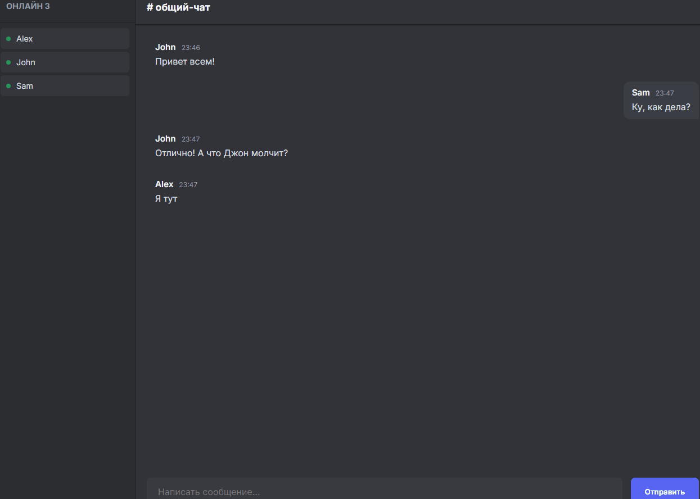

# 💬 Nexus Chat - Realtime Messenger

Полнофункциональный веб-мессенджер, работающий в реальном времени. Проект демонстрирует работу с протоколом **WebSockets**, асинхронным бэкендом и управлением состоянием на фронтенде.

## 🔥 Особенности проекта

*   **Real-time обмен сообщениями:** Сообщения доставляются мгновенно (без перезагрузки страницы) благодаря библиотеке Socket.IO.
*   **Сохранение истории:** Все сообщения записываются в базу данных SQLite и подгружаются при входе нового пользователя.
*   **Список онлайн-пользователей:** Динамический список участников чата обновляется в реальном времени (когда кто-то заходит или выходит).
*   **Современный UI:** Темная тема в стиле Discord, разделение на свои и чужие сообщения, автоматический скролл вниз при новом сообщении.
*   **Защита от XSS:** Безопасный рендеринг текста через `textContent`.

## 🛠 Технологии
*   **Backend:** Python (Flask), Flask-SocketIO
*   **Database:** SQLite3
*   **Frontend:** HTML5, CSS3, Vanilla JavaScript
*   **Real-time:** Socket.IO

## ⚙️ Запуск
1. Установите зависимости: `pip install flask flask-socketio`
2. Запустите сервер: `python app.py`
3. Откройте две вкладки в браузере: `http://127.0.0.1:5000`
4. Войдите под разными именами и напишите сообщение — оно мгновенно появится в обеих вкладках!
